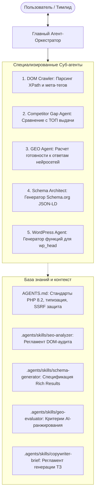

# SEO Sentinel — AI Search & GEO Copilot 🛡️🚀

> **Next-Gen Multi-Agent SEO & Generative Engine Optimization Platform**  
> *Инженерная мультиагентная платформа глубокого технического SEO-аудита, анализа поисковых лидеров и оптимизации под AI-поисковики (GEO: Perplexity, ChatGPT, Google AI Overviews).*

[](https://php.net)
[](#-архитектура-и-стек-технологий)
[-success?style=flat-square)](#)
[](#-агентная-система-агенты-правила-и-скиллы)
[](LICENSE)

---

## 📌 О проекте

В 2025–2026 годах классического SEO с подбором плотности ключей больше недостаточно. Поисковые алгоритмы Google и Яндекса переходят к **GEO (Generative Engine Optimization)**, а миллионы пользователей ищут информацию напрямую через **Perplexity, ChatGPT Search и Google AI Overviews**.

Если веб-страница не структурирована под извлечение сущностей, в ней нет вопросно-ответной структуры (Q&A), таблиц и семантической микроразметки `JSON-LD`, нейросети **игнорируют сайт** и рекомендуют конкурентов.

**SEO Sentinel** решает эту задачу автономно:
1. 🔍 **Мгновенный On-Page & DOM аудит**: Анализ мета-тегов, иерархии H1-H6, ALT у картинок, канонических ссылок (`canonical`) и скорости отклика (TTFB).
2. 📊 **Анализ упущенного контента (Content Gap)**: Сравнение страницы с обязательными смысловыми блоками лидеров поисковой выдачи (блоки цен, FAQ, гарантий, этапов работ).
3. 🤖 **Индекс готовности к AI-поиску (GEO Score)**: Оценка фактологической плотности и цитируемости в ответах LLM-моделей.
4. 🧩 **Автогенерация валидной микроразметки Schema.org**: Создание готового `JSON-LD` (`FAQPage`, `Service`, `BreadcrumbList`) в 1 клик.
5. 🔍 **Живая симуляция сниппета SERP**: Визуализация отображения страницы в Google и Яндексе с детекцией обрезки заголовков Title (> 60 симв.).
6. 📝 **Генератор ТЗ копирайтеру & AI-промптов**: Автоматическое ТЗ с LSI-ключами и системным промптом для ChatGPT/Claude.
7. 🔌 **WordPress Интеграция**: Готовый PHP-код для хука `wp_head` в `functions.php` без сторонних плагинов.
8. 🛡️ **Обход Cloudflare WAF / Капчи**: Поддержка режима прямого анализа по вставке «сырого» HTML-кода со страниц под защитой.
9. 🖨️ **Экспорт коммерческого аудита в PDF**: Чистые print-стили для мгновенной печати отчетов для клиентов веб-студии.

---

## 🤖 Агентная система: Агенты, Правила и Скиллы

Проект спроектирован по парадигме **Agentic Coding** в среде **Antigravity CLI**:



### 1. Системные правила (`AGENTS.md`)
Файл `AGENTS.md` в корне репозитория задает обязательные правила для любого ИИ-агента, работающего с проектом:
- Строгая типизация PHP 8.2 (`declare(strict_types=1);`).
- Защита от SSRF при выполнении HTTP-запросов.
- Использование пользовательских исключений `SeoException`.
- Нулевые внешние зависимости (Zero Dependencies).

### 2. Модульные Скиллы (`.agents/skills/`)
Каждый скилл — это отдельный регламент процедуры (runbook):
- **`seo-analyzer`**: Правила длины Title (40–65 симв.), Description (120–160 симв.), валидация канонических ссылок.
- **`schema-generator`**: Спецификации Google Rich Results для разметки `FAQPage`, `Service`, `BreadcrumbList`.
- **`geo-evaluator`**: Чек-лист цитируемости RAG-системами (вопросно-ответные заголовки, таблицы, списки, E-E-A-T).
- **`copywriter-brief`**: Алгоритм расчета дефицита слов и сборки промпта для копирайтера.

---

## 🏗️ Архитектура и стек технологий

- **Язык:** PHP 8.2+ (CLI & Web через Docker).
- **Стандарты:** ООП, Пространство имен `SeoSentinel\...`, автозагрузка **PSR-4**.
- **Нулевые зависимости:** Использованы нативные высокопроизводительные C-модули PHP (`dom`, `libxml`, `curl`, `json`, `mbstring`). Никаких тяжелых node_modules или вендоров.
- **Фронтенд:** Tailwind CSS (CDN), Google Fonts, Lucide Icons, мобильная адаптивность, стили `@media print`.
- **API:** Встроенный REST API (`?api=1` или заголовок `Accept: application/json`).

---

## 📂 Структура репозитория

```text
├── .agents/
│   └── skills/
│       ├── copywriter-brief/SKILL.md  # Регламент формирования ТЗ и AI-промптов
│       ├── geo-evaluator/SKILL.md     # Чек-лист ранжирования в Generative AI Search
│       ├── schema-generator/SKILL.md  # Спецификация валидации микроразметки Google
│       ├── seo-analyzer/SKILL.md      # Регламент технического анализа DOM
│       └── wp-block/SKILL.md          # Скилл создания Gutenberg-блоков
├── bin/
│   └── seo-sentinel                   # Консольная CLI-утилита для терминала
├── public/
│   └── index.php                      # Интерактивный Web-дашборд и JSON API
├── src/
│   ├── Analyzer/
│   │   ├── CompetitorAnalyzer.php     # Анализ поискового бенчмарка и Content Gap
│   │   └── PageCrawler.php            # Парсер HTML через DOMDocument & XPath
│   ├── Evaluator/
│   │   └── GeoScorer.php              # Оценка цитируемости в Perplexity/ChatGPT
│   ├── Exception/
│   │   └── SeoException.php           # Пользовательские исключения
│   ├── Generator/
│   │   ├── CopywriterBriefGenerator.php # Генератор ТЗ и промптов для ChatGPT
│   │   ├── SchemaGenerator.php        # Генератор валидного JSON-LD
│   │   ├── SerpPreviewData.php        # Симулятор сниппета выдачи Google/Яндекс
│   │   └── WordPressIntegrationGenerator.php # Генератор кода для functions.php
│   ├── Http/
│   │   └── Client.php                 # Безопасный cURL-клиент (WAF/Cloudflare detector)
│   ├── Service/
│   │   └── AuditService.php           # Сервис-оркестратор полного аудита
│   └── autoload.php                   # PSR-4 автозагрузчик классов
├── AGENTS.md                          # Контекстные инструкции для ИИ-агентов
└── README.md
```

---

## 🚀 Быстрый старт

### 1. Запуск интерактивного Веб-Дашборда

```bash
docker run -d --name seo_sentinel_web --net=host -v "$PWD:/app" -w /app wordpress:6.6-php8.2-apache php -S 0.0.0.0:8000 -t public
```

Откройте в браузере: **`http://localhost:8000`**

### 2. Запуск консольного аудита (CLI)

```bash
docker run --rm --net=host -v "$PWD:/app" -w /app wordpress:6.6-php8.2-apache php bin/seo-sentinel analyze https://wordpress.org --keyword="content management system"
```

### 3. Использование в качестве REST API

```bash
curl -s "http://localhost:8000/?api=1&url=https://wordpress.org&keyword=cms"
```

---

## 💼 Коммерческая ценность & Use Cases

1. **Экспресс-аудиты перед продажей услуг:** Мгновенная генерация PDF-отчетов для клиентов с наглядным списком критических проблем (неверный Canonical, обрезка Title, медленный отклик).
2. **Внедрение семантической разметки:** Автоматическая генерация кода Schema.org для сайтов клиентов без необходимости нанимать бэкенд-разработчика.
3. **Подготовка контента нового поколения:** Автоматическое составление ТЗ копирайтерам с учетом требований алгоритмов AI-поиска (Perplexity, ChatGPT).
4. **Портфолио сеньор-уровня:** Демонстрация глубокого понимания современного чистого PHP 8.2, работы с DOM и методологии Agentic Coding.

---

## 👤 Автор

Разработано: **[Lelyaler](https://github.com/Lelyaler)**  
Стек: **PHP 8.2 • Modern Web • AI / GEO Optimization • Agentic Engineering**
