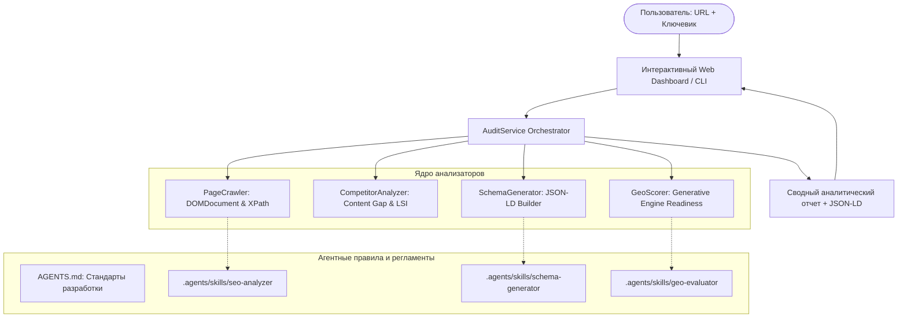

# SEO Sentinel — AI Search & GEO Copilot 🛡️🚀

> **Next-Gen Multi-Agent SEO & Generative Engine Optimization Platform**  
> *Полнофункциональная платформа глубокого SEO-аудита, анализа конкурентов в поисковой выдаче и оптимизации под AI-поисковики (GEO: Perplexity, ChatGPT, Google AI Overviews).*

---

## 📌 О проекте

**SEO Sentinel** — это современный инженерный инструмент для SEO-специалистов, веб-разработчиков и владельцев бизнеса. 

В 2025–2026 годах классического SEO недостаточно: алгоритмы переходят к **GEO (Generative Engine Optimization)**. Если страница не структурирована под извлечение сущностей, ИИ-поисковики (Perplexity, ChatGPT Search, Gemini) не включают сайт в свои ответы. 

**SEO Sentinel** автоматизирует рутину, на которую уходит 2–3 часа работы SEO-специалиста:
1. 🔍 **Аудит страницы и мета-данных** (Title, Meta Description, OpenGraph, канонические ссылки, заголовки H1-H6, ALT у картинок).
2. 📊 **Анализ упущенного контента (Content Gap)** в сравнении со стандартами ТОП-3 поисковой выдачи (блоки цен, FAQ, гарантий, этапов работ).
3. 🧩 **Автогенерация валидной микроразметки Schema.org (JSON-LD)** (`FAQPage`, `Service`, `BreadcrumbList`) с возможностью копирования в 1 клик.
4. 🤖 **Индекс готовности к AI-поиску (GEO Score)**: оценка фактологической плотности, вопросно-ответной структуры (Q&A) и сигналов E-E-A-T.

---

## 🏗️ Архитектура и стек технологий

Проект разработан в парадигме **Agentic Engineering** с использованием **Antigravity CLI**:
- **Язык:** Чистый **PHP 8.2+** со строгой типизацией (`declare(strict_types=1);`), ООП и автозагрузкой по стандарту **PSR-4**.
- **Нулевые внешние зависимости:** Максимальная производительность и безопасность за счет нативных модулей PHP (`dom`, `libxml`, `curl`, `json`, `mbstring`).
- **Фронтенд:** Интерактивный дашборд на **Tailwind CSS**, оптимизированный для мобильных устройств и десктопа.
- **REST API:** Поддержка получения данных в формате JSON для интеграции с внешними микросервисами и агентами.



---

## 📂 Структура проекта

```text
├── .agents/
│   └── skills/
│       ├── seo-analyzer/SKILL.md      # Регламент технического анализа DOM и мета-данных
│       ├── schema-generator/SKILL.md  # Спецификация валидации микроразметки Google Rich Results
│       └── geo-evaluator/SKILL.md     # Чек-лист ранжирования в Generative AI Search
├── bin/
│   └── seo-sentinel                   # Исполняемый консольный CLI-скрипт
├── public/
│   └── index.php                      # Веб-дашборд и REST API эндпоинт
├── src/
│   ├── Analyzer/
│   │   ├── CompetitorAnalyzer.php     # Анализ поискового бенчмарка и Content Gap
│   │   └── PageCrawler.php            # Парсер HTML через DOM & XPath
│   ├── Evaluator/
│   │   └── GeoScorer.php              # Оценка цитируемости в Perplexity/ChatGPT
│   ├── Exception/
│   │   └── SeoException.php           # Пользовательские исключения
│   ├── Generator/
│   │   └── SchemaGenerator.php        # Генератор JSON-LD разметки
│   ├── Http/
│   │   └── Client.php                 # Защищенный cURL-клиент (SSRF Protection)
│   ├── Service/
│   │   └── AuditService.php           # Главный сервис-оркестратор
│   └── autoload.php                   # PSR-4 автозагрузчик
├── AGENTS.md                          # Контекстные инструкции для ИИ-агентов
└── README.md
```

---

## 🚀 Как запустить проект

### Вариант 1: Запуск интерактивного Веб-Дашборда

Сервер запускается в Docker на базе PHP 8.2:

```bash
docker run -d --name seo_sentinel_web --net=host -v "$PWD:/app" -w /app wordpress:6.6-php8.2-apache php -S 0.0.0.0:8000 -t public
```

Откройте в браузере: **`http://localhost:8000`**

### Вариант 2: Запуск через консольный CLI

```bash
docker run --rm --net=host -v "$PWD:/app" -w /app wordpress:6.6-php8.2-apache php bin/seo-sentinel analyze https://wordpress.org --keyword="content management system"
```

### Вариант 3: Использование в качестве REST API

```bash
curl -s "http://localhost:8000/?api=1&url=https://wordpress.org&keyword=cms"
```

---

## 💼 Ценность для портфолио

- **Демонстрация сильного бэкенда:** Чистый ООП PHP 8.2 без раздутых зависимостей и фреймворков.
- **Понимание трендов 2026 года:** Реализация алгоритмов **GEO (Generative Engine Optimization)** и структуры **Schema.org**.
- **Практика Agentic Coding:** Проект спроектирован с использованием контекстных правил (`AGENTS.md`) и модульных скиллов (`.agents/skills/`), демонстрируя продвинутые навыки парного программирования с автономными ИИ-агентами.
